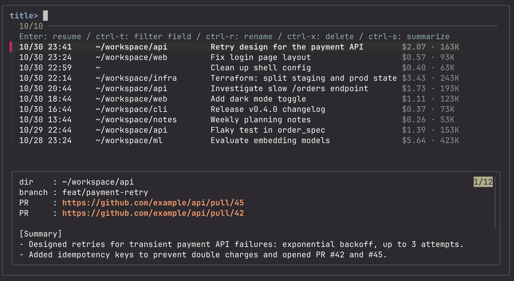

# cch

[English](README.md) | 日本語 | [简体中文](README.zh.md)

Claude Code の会話のハイライトを見るためのツールです。

> cch は非公式のツールで、Anthropic とは関係がなく、Anthropic の推奨を受けたものでもありません。

Claude Code の会話を、リポジトリをまたいで一覧・検索・再開する fzf ベースのツールです。会話ごとの AI 要約と、API 換算の料金・コンテキスト量を一覧で確認できます。

Claude Code は起動したディレクトリごとに会話を保存するため、リポジトリが増えると過去の会話が散らばって探しにくくなります。cch は `~/.claude/projects/` 以下の全会話を1つの一覧にまとめ、選んだ会話をそのディレクトリで再開します。



## 特徴

- **全リポジトリ横断の一覧と再開**：Enter で、その会話を始めたディレクトリに移動して `claude -r` で再開します。
- **本文の検索**：ctrl-t で「本文」に切り替えるか `cch <語句>` で開くと、題名・あなたの指示・Claude の返答に語句を含む会話を探します。画像、ツールの呼び出しと実行結果、1万字を超える文章（ページの丸ごとの貼り付けなど）は検索しません。
- **AI 要約のプレビュー**：`cch summarize`（一覧では ctrl-s）で会話ごとに2〜3行の要約を作り、プレビューに表示します。要約中は進み具合のバーが出ます。
- **料金とコンテキスト量**：題名の右に、API 換算の料金（サブエージェント込み）と直近のコンテキスト量を薄く表示します。
- **名前変更・削除**：Claude Code の `/rename` と同じ形式で名前を変え、削除はゴミ箱に移します。
- **英語・日本語・中国語**：初回の起動で言語を選びます。画面の文言と要約の両方に効きます。
- **bash 1ファイル**：fzf・jq・ripgrep の上に作っています。

## 必要なもの

- macOS（`stat -f`・`tail -r`・`trash` を使っています。Linux は未対応です）
- bash, perl, curl（macOS に標準で入っています）
- [fzf](https://github.com/junegunn/fzf)（0.65 で動作確認）
- [jq](https://jqlang.github.io/jq/)
- [ripgrep](https://github.com/BurntSushi/ripgrep)（`rg`）
- [Claude Code](https://docs.claude.com/en/docs/claude-code)（`claude` コマンド）

fzf・jq・ripgrep が入っていない場合は、Homebrew で入れるか聞きます。

## インストール

Homebrew の場合（fzf・jq・ripgrep も一緒に入ります）：

```sh
brew install nodematerial/tap/cch
```

ソースから入れる場合：

```sh
git clone https://github.com/nodematerial/cch.git
ln -s "$PWD/cch/cch" /usr/local/bin/cch   # PATH の通った場所なら どこでも可
```

## 使い方

```sh
cch                 # 全会話を新しい順に表示
cch <語句>          # 本文で絞り込んだ状態で開く（会話の本文に語句を含むものだけ表示）
cch -p [語句]       # 再開せず一覧だけ出力する
cch summarize [件数] # 要約がない・古い会話を新しい順に要約する（既定20件、all ですべて）
cch lang            # 表示の言語を選び直す（en / ja / zh）
cch help            # コマンドとキーの一覧を表示する（-h, --help でも可）
cch --version       # バージョンを表示する
```

### 環境変数

| 変数 | 既定 | 用途 |
|---|---|---|
| `CCH_LANG` | 保存した言語、なければ `en` | 言語。`en`・`ja`・`zh` のどれか。保存した言語より優先します |
| `CLAUDE_CONFIG_DIR` | `~/.claude` | Claude Code のデータの保存場所（Claude Code 本体と同じ変数） |
| `CCH_CACHE_DIR` | `~/.cache/cch` | cch のキャッシュと要約の保存場所 |

### 一覧でのキー操作

| キー | 動作 |
|---|---|
| Enter | 会話を再開する |
| ctrl-t | 絞り込む対象を タイトル → 本文 → 日付 → dir の順に切り替える。本文では、打った語句を含む会話を探し直す |
| ctrl-r | 名前を変える（Esc で中止） |
| ctrl-x | ゴミ箱に移す（Enter / y で実行、ほかのキーで中止） |
| ctrl-s | 要約のない会話を要約する（Enter/y で直近20件、`all` と入力ですべて） |

上下の移動などは fzf の既定、またはあなたの fzf の設定に従います。

### プレビュー

ディレクトリ、ブランチ、その会話で作った PR（新しい順に最大5件）、要約、あなたが最後に書いた発言を表示します。

PR の URL はリンクになっています。fzf が普通のクリックを受け取ってしまうので、shift も一緒に押してください（Ghostty なら shift+cmd+クリック）。

## 料金の表示について

- 料金は、会話ファイルに記録されたトークン数と [LiteLLM の公開料金表](https://github.com/BerriAI/litellm/blob/main/model_prices_and_context_window.json) から計算した **API 換算の目安** です。
- Claude の定額プラン（Pro / Max / Team など）を使っている場合、実際の請求額ではありません。
- 料金表は有志が管理しているため、値が実際と異なることがあります。

## データと外部通信

cch は Claude Code の会話ファイル（`~/.claude/projects/` 以下）を読みます。会話の内容を外部に送るのは `cch summarize` を実行したときだけです。

| 処理 | 内容 |
|---|---|
| 料金表の取得 | 料金表がない、または7日以上古いときに、GitHub から LiteLLM の料金表を取得します。送信するものはありません。 |
| `cch summarize` | 会話から、ユーザーの指示と Claude の返答の本文を抜き出し、`claude -p --model claude-haiku-4-5`（Haiku 4.5）に渡して要約させます。**会話の内容が、あなたの Claude Code が使っているプロバイダ（Anthropic API など）に送られ、料金がかかります。** 業務の会話も対象になるので、所属先のルールを確認してから使ってください。 |

ローカルに保存・変更するものは次のとおりです。

- `~/.cache/cch/index.v2.tsv`：一覧のキャッシュ。作業ディレクトリのパスと会話の題名を平文で保存します。
- `~/.cache/cch/summaries/<言語>/`：要約。言語ごとのフォルダに平文で保存します。
- `~/.config/cch/lang`：選んだ言語。
- `~/.cache/cch/prices.json`：料金表。
- 名前変更（ctrl-r）は、会話ファイルに1行追記します。
- 削除（ctrl-x）は、会話ファイル・同名のフォルダ・要約をゴミ箱に移します。

## 注意

- 会話ファイルの形式は Claude Code の内部仕様で、公開されたものではありません。Claude Code の更新で cch が動かなくなることがあります。
- 一覧を初めて表示するときは、全会話を読むので時間がかかります（進み具合のバーが出ます）。2回目以降はキャッシュを使います。
- 要約を作るときの claude の作業ディレクトリは `~/.cache/cch/` です。このため `~/.claude/projects/` に空のフォルダが1つできます。

## 開発

```sh
brew install bats-core shellcheck
shellcheck cch
bats test/
```

push するたびに、GitHub Actions で両方を実行します。

## ライセンス

[MIT](../LICENSE)
