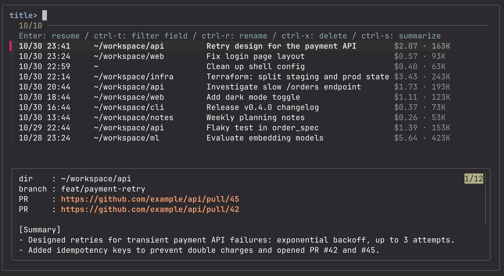

# cch

English | [日本語](README.ja.md) | [简体中文](README.zh.md)

Highlights for your Claude Code conversations.

> cch is an unofficial tool and is not affiliated with or endorsed by Anthropic.

A fzf-based tool to list, search and resume your Claude Code conversations across all projects, with AI summaries and API-equivalent cost and context size for each conversation.

Claude Code stores conversations per launch directory, so once you work in several repositories, past conversations get scattered and hard to find. cch gathers every conversation under `~/.claude/projects/` into a single list, and resumes the one you pick in the directory where it started.



## Features

- **Cross-project list and resume**: press Enter to `cd` into the conversation's directory and run `claude -r`.
- **Content search**: switch to content with ctrl-t, or open with `cch <word>`, to find conversations whose title, your prompts or Claude's replies contain the word. Images, tool calls and results, and texts over 10,000 characters (such as whole pages pasted in) are not searched.
- **AI summaries in the preview**: `cch summarize` (or ctrl-s in the list) writes a 2–3 line summary for each conversation and shows it in the preview, with a progress bar while it runs.
- **Cost and context size**: shown dimly to the right of each title — API-equivalent cost (including subagents) and the latest context size.
- **Rename and delete**: rename using the same format as Claude Code's `/rename`; delete moves files to the Trash.
- **English, Japanese and Chinese**: choose the language on first launch; it applies to the UI and to summaries.
- **A single bash file**: built on fzf, jq and ripgrep.

## Requirements

- macOS, or Linux with GNU coreutils or uutils (Ubuntu 25.10 and later). Tested in CI on Ubuntu, Debian, Fedora and Arch Linux. BusyBox-based systems such as Alpine are not supported
- bash, perl, curl (preinstalled on macOS and most Linux distributions)
- [fzf](https://github.com/junegunn/fzf) 0.38 or later; ctrl-t needs 0.58 or later
- [jq](https://jqlang.github.io/jq/)
- [ripgrep](https://github.com/BurntSushi/ripgrep) (`rg`)
- [Claude Code](https://docs.claude.com/en/docs/claude-code) (the `claude` command)

If fzf, jq or ripgrep is missing, cch offers to install it with Homebrew.

With an fzf older than 0.58, such as the one in Ubuntu 24.04 or Debian 12, everything works except ctrl-t: only titles are filtered in the list, and content search is `cch <word>`. The list says so at the top. For ctrl-t, get the latest fzf from Homebrew or [the fzf releases page](https://github.com/junegunn/fzf/releases).

On Linux, Delete (ctrl-x) moves files to the Trash with `gio trash` (preinstalled on most desktops) or `trash-put` from trash-cli.

## Installation

With Homebrew (installs fzf, jq and ripgrep as well):

```sh
brew install nodematerial/tap/cch
```

Or from source:

```sh
git clone https://github.com/nodematerial/cch.git
ln -s "$PWD/cch/cch" /usr/local/bin/cch   # any directory on your PATH works
```

## Usage

```sh
cch                   # list all conversations, newest first
cch <word>            # open filtered by content: only conversations that contain <word>
cch -p [word]         # print the list without opening fzf
cch summarize [count] # summarize conversations with no or stale summary, newest first (default 20, or all)
cch lang              # choose the display language (en / ja / zh)
cch help              # show the commands and keys (also -h, --help)
cch --version         # show the version
```

### Environment variables

| Variable | Default | Purpose |
|---|---|---|
| `CCH_LANG` | saved choice, or `en` | Language: `en`, `ja` or `zh`. Overrides the saved choice |
| `CLAUDE_CONFIG_DIR` | `~/.claude` | Where Claude Code keeps its data (same variable as Claude Code) |
| `CCH_CACHE_DIR` | `~/.cache/cch` | Where cch keeps its cache and summaries |

### Keys in the list

| Key | Action |
|---|---|
| Enter | Resume the conversation |
| ctrl-t | Cycle the filter target: title → content → date → dir. In content, the typed word searches the conversations again (fzf 0.58 or later) |
| ctrl-r | Rename (Esc to cancel) |
| ctrl-x | Move to Trash (Enter / y to confirm, any other key cancels) |
| ctrl-s | Summarize conversations without a summary: Enter/y for the latest 20, type `all` for all |

Cursor movement and other keys follow fzf's defaults or your own fzf settings.

### Preview

Shows the directory, git branch, PRs created in the conversation (latest 5), the summary, and the last message you wrote.

PR URLs are hyperlinks. fzf takes plain mouse clicks for itself, so hold shift as well (shift+cmd+click in Ghostty).

## About the cost

- Cost is an **API-equivalent estimate** computed from the token counts recorded in the conversation files and [LiteLLM's public price table](https://github.com/BerriAI/litellm/blob/main/model_prices_and_context_window.json).
- If you are on a Claude subscription plan (Pro / Max / Team, etc.), it is not what you are actually billed.
- The price table is community-maintained and may differ from actual prices.

## Data and network access

cch reads Claude Code's conversation files under `~/.claude/projects/`. Conversation content leaves your machine only when you run `cch summarize`.

| Operation | What happens |
|---|---|
| Fetching the price table | When the cached table is missing or older than 7 days, cch downloads LiteLLM's price table from GitHub. Nothing is sent. |
| `cch summarize` | Extracts your prompts and Claude's replies from each conversation and passes them to `claude -p --model claude-haiku-4-5` (Haiku 4.5). **The content is sent to whichever provider your Claude Code uses (e.g. the Anthropic API), and usage is billed.** Work conversations are included, so check your organization's policy before using it. |

Files cch writes or modifies locally:

- `~/.cache/cch/index.v2.tsv`: list cache. Stores working directory paths and conversation titles in plain text.
- `~/.cache/cch/summaries/<lang>/`: summaries, in plain text, one directory per language.
- `~/.config/cch/lang`: the chosen language.
- `~/.cache/cch/prices.json`: the price table.
- Rename (ctrl-r) appends one line to the conversation file.
- Delete (ctrl-x) moves the conversation file, its sibling directory and its summary to the Trash.

## Caveats

- The conversation file format is an internal, undocumented part of Claude Code. A Claude Code update may break cch.
- The first listing reads every conversation and takes a while (a progress bar is shown). Later runs use the cache.
- Summaries are generated with `~/.cache/cch/` as the working directory, which creates one empty folder under `~/.claude/projects/`.

## Development

```sh
brew install bats-core shellcheck
shellcheck cch
bats test/
```

GitHub Actions runs both on every push.

## License

[MIT](../LICENSE)
