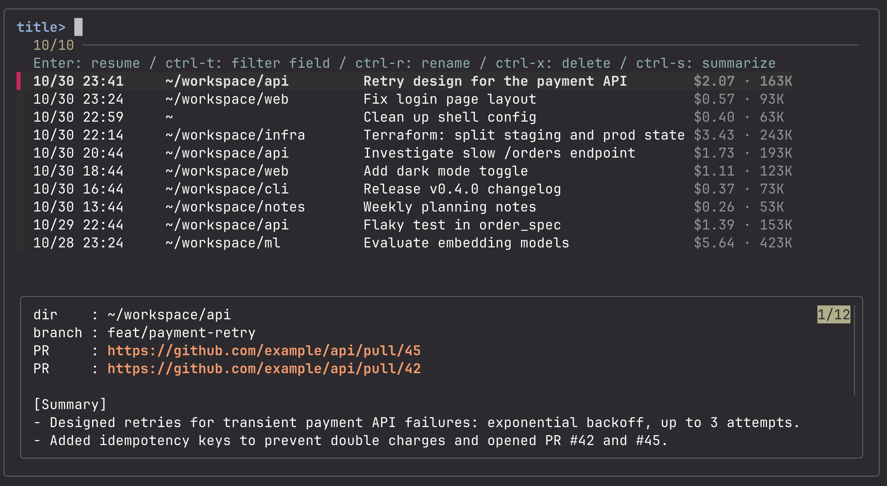

# cch

[English](README.md) | [日本語](README.ja.md) | 简体中文

查看 Claude Code 对话要点的工具。

> cch 是非官方工具，与 Anthropic 无关，也未获得 Anthropic 的认可。

基于 fzf 的工具，可跨所有项目列出、搜索并恢复 Claude Code 对话，并显示每个对话的 AI 摘要、按 API 计价折算的费用和上下文大小。

Claude Code 按启动目录分别保存对话，仓库一多，过去的对话就会分散各处、难以查找。cch 把 `~/.claude/projects/` 下的所有对话汇总成一个列表，并在对话最初所在的目录中恢复你选中的对话。



## 特性

- **跨项目列出与恢复**：按 Enter 会进入该对话所在的目录并执行 `claude -r`。
- **在预览中显示 AI 摘要**：`cch summarize`（在列表中按 ctrl-s）为每个对话生成 2～3 行摘要，并显示在预览中。生成时会显示进度条。
- **费用与上下文大小**：在标题右侧以淡色显示按 API 计价折算的费用（含子代理）和最近一次的上下文大小。
- **重命名与删除**：重命名采用与 Claude Code 的 `/rename` 相同的格式；删除会将文件移到废纸篓。
- **支持英语、日语和中文**：首次启动时选择语言，界面文字和摘要都会使用该语言。
- **单个 bash 文件**：基于 fzf、jq 和 ripgrep。

## 运行要求

- macOS（使用了 `stat -f`、`tail -r` 和 `trash`；暂不支持 Linux）
- bash、perl、curl（macOS 自带）
- [fzf](https://github.com/junegunn/fzf)（已在 0.65 上测试）
- [jq](https://jqlang.github.io/jq/)
- [ripgrep](https://github.com/BurntSushi/ripgrep)（`rg`）
- [Claude Code](https://docs.claude.com/en/docs/claude-code)（`claude` 命令）

如果缺少 fzf、jq 或 ripgrep，cch 会询问是否用 Homebrew 安装。

## 安装

使用 Homebrew（会同时安装 fzf、jq 和 ripgrep）：

```sh
brew install nodematerial/tap/cch
```

或从源码安装：

```sh
git clone https://github.com/nodematerial/cch.git
ln -s "$PWD/cch/cch" /usr/local/bin/cch   # 放在 PATH 中的任意目录均可
```

## 用法

```sh
cch                   # 按时间从新到旧列出所有对话
cch <词语>            # 只显示内容中包含 <词语> 的对话
cch -p [词语]         # 不打开 fzf，只输出列表
cch summarize [数量]  # 按时间从新到旧，为没有摘要或摘要已过时的对话生成摘要（默认 20 个，all 为全部）
cch lang              # 选择显示语言（en / ja / zh）
cch help              # 显示命令和按键一览（也可用 -h、--help）
cch --version         # 显示版本
```

### 环境变量

| 变量 | 默认值 | 用途 |
|---|---|---|
| `CCH_LANG` | 已保存的语言，否则为 `en` | 语言：`en`、`ja` 或 `zh`。优先于已保存的语言 |
| `CLAUDE_CONFIG_DIR` | `~/.claude` | Claude Code 的数据保存位置（与 Claude Code 使用同一变量） |
| `CCH_CACHE_DIR` | `~/.cache/cch` | cch 的缓存和摘要保存位置 |

### 列表中的按键

| 按键 | 操作 |
|---|---|
| Enter | 恢复对话 |
| ctrl-t | 依次切换筛选对象：标题 → 日期 → 目录 |
| ctrl-r | 重命名（Esc 取消） |
| ctrl-x | 移到废纸篓（Enter / y 确认，其他键取消） |
| ctrl-s | 为没有摘要的对话生成摘要（Enter/y：最近 20 个，输入 `all`：全部） |

光标移动等其他按键遵循 fzf 的默认设置或你自己的 fzf 设置。

### 预览

显示目录、git 分支、对话中创建的 PR（最近 5 个）、摘要以及你最后写的一条消息。

PR 的 URL 是超链接。由于 fzf 会接收普通的鼠标点击，请同时按住 shift（在 Ghostty 中为 shift+cmd+点击）。

## 关于费用

- 费用是根据对话文件中记录的 token 数和 [LiteLLM 的公开价格表](https://github.com/BerriAI/litellm/blob/main/model_prices_and_context_window.json) 计算出的 **按 API 计价折算的估算值**。
- 如果你使用的是 Claude 订阅套餐（Pro / Max / Team 等），它并不是你实际被收取的金额。
- 价格表由社区维护，可能与实际价格不同。

## 数据与网络访问

cch 会读取 `~/.claude/projects/` 下 Claude Code 的对话文件。只有在运行 `cch summarize` 时，对话内容才会离开你的电脑。

| 操作 | 内容 |
|---|---|
| 获取价格表 | 当缓存的价格表不存在或超过 7 天时，cch 会从 GitHub 下载 LiteLLM 的价格表。不会发送任何内容。 |
| `cch summarize` | 从每个对话中提取你的指令和 Claude 的回复，传给 `claude -p --model claude-haiku-4-5`（Haiku 4.5）生成摘要。**对话内容会发送到你的 Claude Code 所使用的服务商（如 Anthropic API），并产生费用。** 工作中的对话也包含在内，使用前请确认所在组织的规定。 |

cch 在本地写入或修改的文件：

- `~/.cache/cch/index.v2.tsv`：列表缓存。以明文保存工作目录路径和对话标题。
- `~/.cache/cch/summaries/<语言>/`：摘要，以明文按语言分目录保存。
- `~/.config/cch/lang`：所选的语言。
- `~/.cache/cch/prices.json`：价格表。
- 重命名（ctrl-r）会在对话文件末尾追加一行。
- 删除（ctrl-x）会把对话文件、同名目录及其摘要移到废纸篓。

## 注意事项

- 对话文件的格式是 Claude Code 内部未公开的规格。Claude Code 更新后，cch 可能无法正常工作。
- 首次显示列表时会读取所有对话，需要一些时间（会显示进度条）。之后会使用缓存。
- 生成摘要时以 `~/.cache/cch/` 作为工作目录，因此会在 `~/.claude/projects/` 下产生一个空文件夹。

## 开发

```sh
brew install bats-core shellcheck
shellcheck cch
bats test/
```

每次 push 时，GitHub Actions 都会运行这两项检查。

## 许可证

[MIT](../LICENSE)
